# TwinGuard-SD-IoT

Code, notebooks, and results for the paper

> **TwinGuard-SD-IoT: A Fidelity-Aware GNN Digital Twin and Agentic AI Framework for Proactive QoS Assurance in Software-Defined IoT Networks**
> Jamal Et-Tousy, LAPSSII Laboratory, Higher School of Technology (EST), Cadi Ayyad University, Safi, Morocco.
> Manuscript under review.

TwinGuard-SD-IoT separates *proposing* a network reconfiguration from *authorizing* it. Agents propose SDN
actions, an action-conditioned spatio-temporal GNN digital twin predicts their QoS impact, and the
**TwinGuard** safety engine decides, at every decision epoch, whether the twin can be trusted (run-time
fidelity score) and whether the SLA holds (adaptive conformal upper bounds) before an action is enforced.

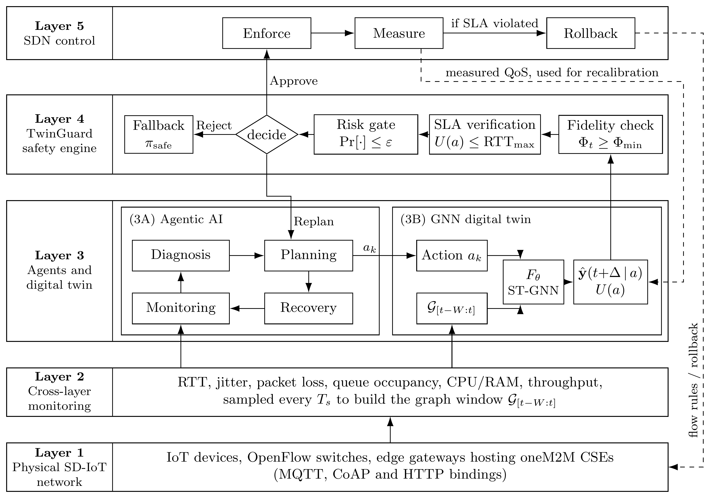

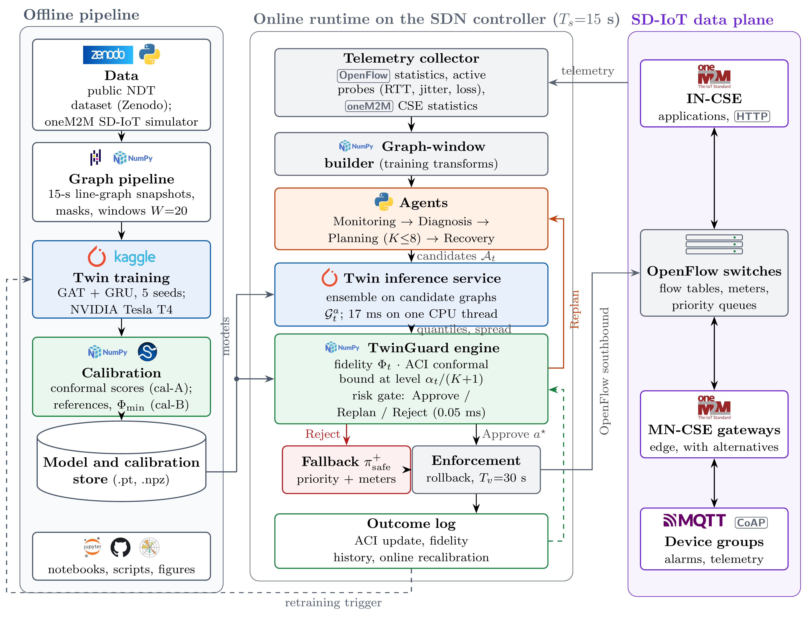

## How TwinGuard decides

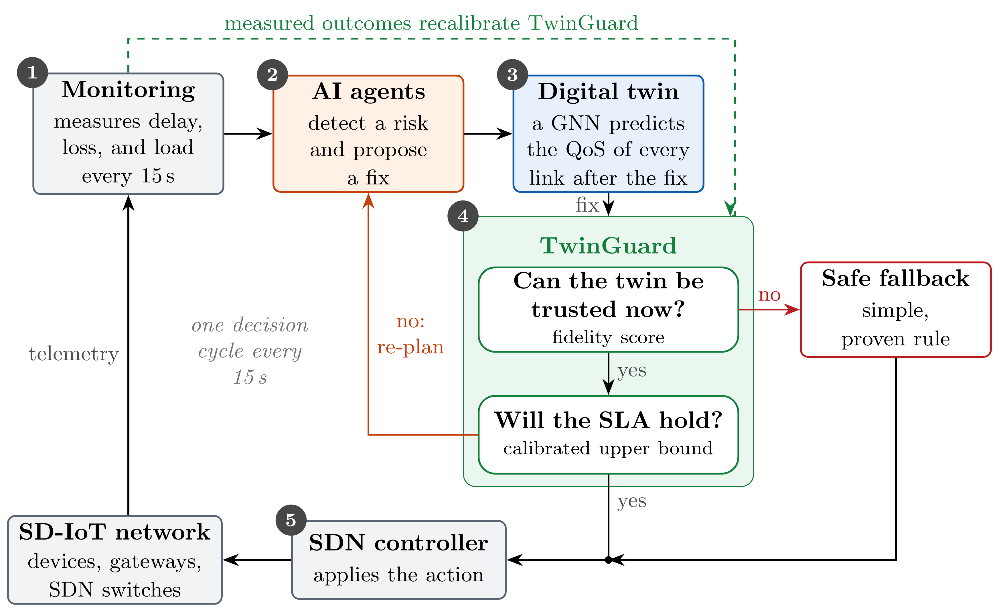

At every decision epoch (15 s) and for every link, TwinGuard

1. **checks fidelity:** a score $\Phi_t \in [0, 1]$ combines four run-time signals (tracking error, coverage
   gap, disagreement of the ensemble members, missing measurements); if $\Phi_t < \Phi_{\min}$ it
   **abstains** and a safe fallback acts;
2. **verifies the SLA:** it widens the twin's 0.95 quantiles of RTT and loss by a conformal margin that is
   adapted online with adaptive conformal inference (ACI), and **approves** only if both bounds are within
   budget; otherwise it asks for an **intervention**;
3. **updates** the ACI level and the fidelity history once the outcome is measured.

The gate is implemented as an online class (`TwinGuard` in `notebooks/TwinGuard_gate.ipynb`) that only uses
information available at decision time, and is checked against an independent vectorized implementation.

## Main results

All numbers are scored against observed outcomes of a public network-digital-twin dataset
(9 routers, 13 links; D1 without impairment, D3 moderate shift, D2 severe shift).

Values are for the five-seed ensemble; ± is the standard deviation over the five training seeds (forecasts:
single-seed models; TwinGuard: the whole gate re-run on the five leave-one-seed-out ensembles).

| | Result |
|---|---|
| SLA-violation prediction (AUROC, 15 s ahead) | 0.948 ± 0.002 in distribution, 0.920 ± 0.008 under moderate shift (per-link GRU: 0.940 ± 0.002 and 0.909 ± 0.004) |
| Twin vs. per-link GRU, paired test | AUROC difference > 0 in every scenario and at every horizon (D1, 15 s: 0.008, 95% CI [0.004, 0.012]; D2, 60 s: 0.122) |
| Coverage of TwinGuard's adaptive conformal bound (target 0.95) | 0.947–0.952 in every scenario, SD ≤ 0.0003 (raw twin quantiles: 0.627 under severe shift) |
| False approvals of TwinGuard's "no intervention needed" verdicts | at most 1.7% in every scenario, e.g. 1.0 ± 0.1% under severe shift (uncalibrated twin: 24.5 ± 0.6%) |
| Fidelity score as a predictor of coverage failure in the next 5 min | AUROC 0.825 (0.824 ± 0.006) |
| Cost of one decision (5-member ensemble, one CPU thread) | 17.1 ms median, 19.4 ms p95; the gate adds about 0.05 ms |

### Forecast quality of the GNN twin

At low false-alarm rates the twin detects more violations than the per-link GRU (77% against 72% at a
false-positive rate of 5% on D1 test; average precision 0.46 against 0.40).

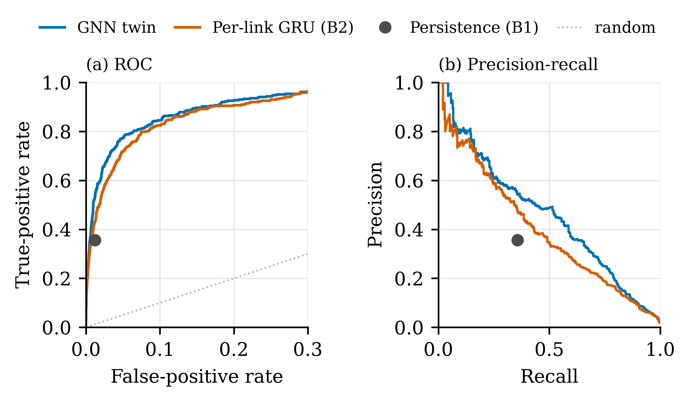

Its violation probability is calibrated in distribution but too low under shift, which is why TwinGuard
recalibrates the bounds and checks the twin's fidelity before trusting it.

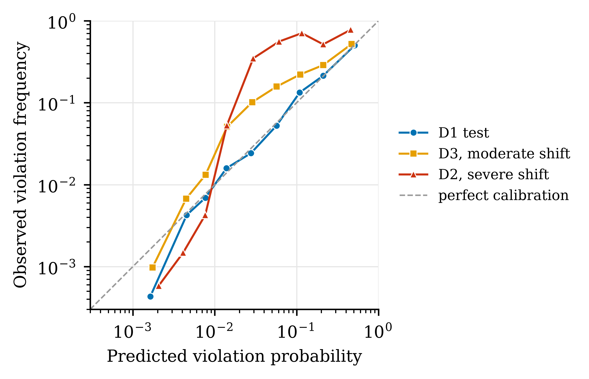

The advantage of message passing grows with the prediction horizon (paired block-bootstrap 95% intervals).

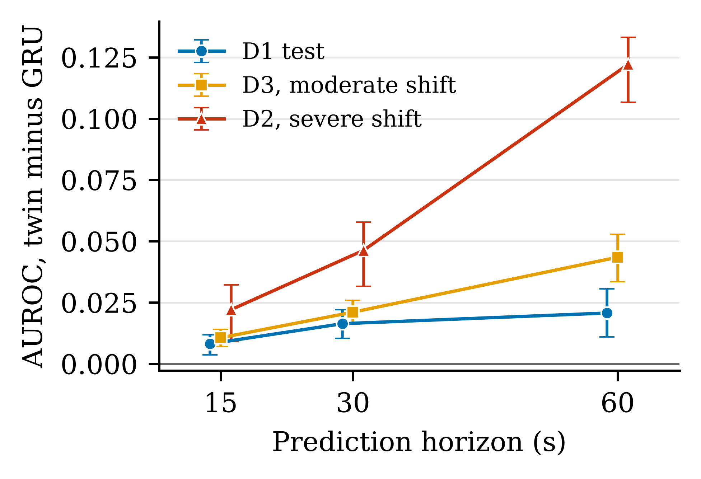

### Training of the GNN twin and the per-link GRU (five seeds each)

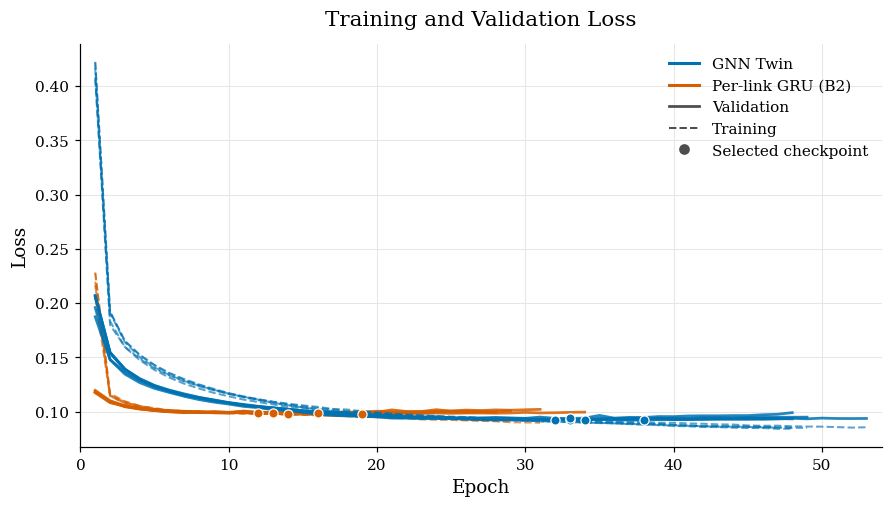

### Coverage under shift: static vs. adaptive conformal bounds

The static bound loses coverage under shift; the adaptive bound returns to the target $\varepsilon = 0.05$.

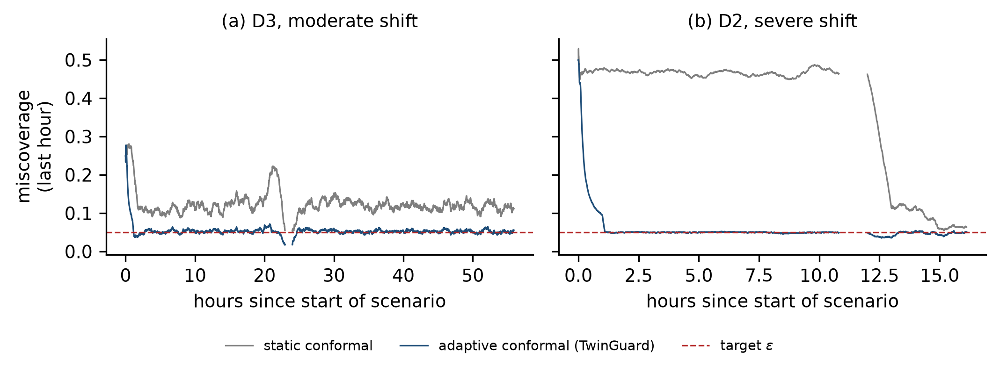

### Fidelity score under shift

The fidelity score drops to zero from the first epoch of the severe shift (D2) and fluctuates around the
threshold under moderate shift (D3).

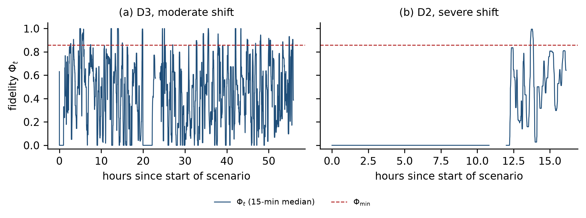

### Verdicts over time

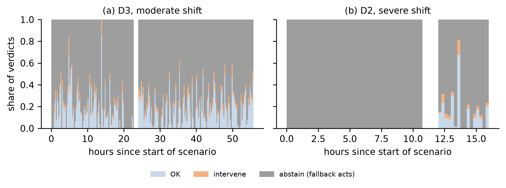

### Closed-loop safety depends on the fallback

Under shift TwinGuard stays safe by abstaining, so the closed loop is only as safe as the policy that takes
over: with a reactive fallback it behaves like reactive control, whereas a fallback that keeps the
calibrated bound (defined post hoc, marked \*) is the safest option but intervenes more often.

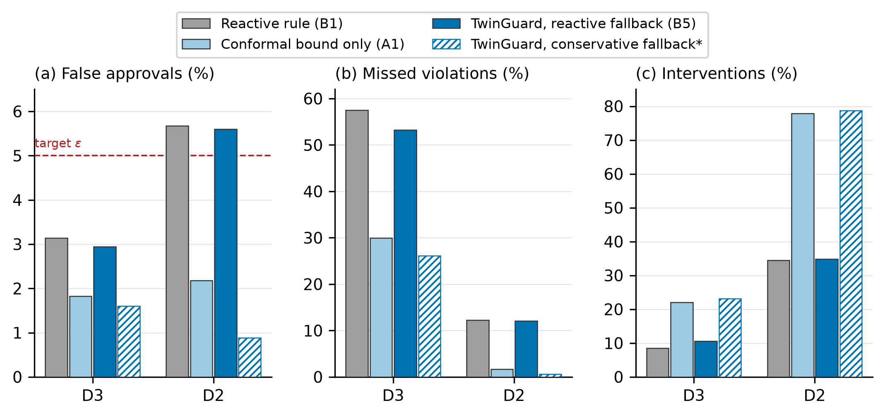

### Lower abstention by online recalibration (no retraining)

When TwinGuard abstains on more than 10% of the epochs of the last hour, the conformal bound and the references
of the fidelity signals are re-estimated on the most recent hour of measured outcomes. Abstention on D3 falls
from 79.6% to 6.0% (D2: from 95.3% to 21.0%) while false approvals stay at or below 1.8% and coverage at
0.948-0.950; the cost is more interventions (D3: 20.3% of the link-epochs).

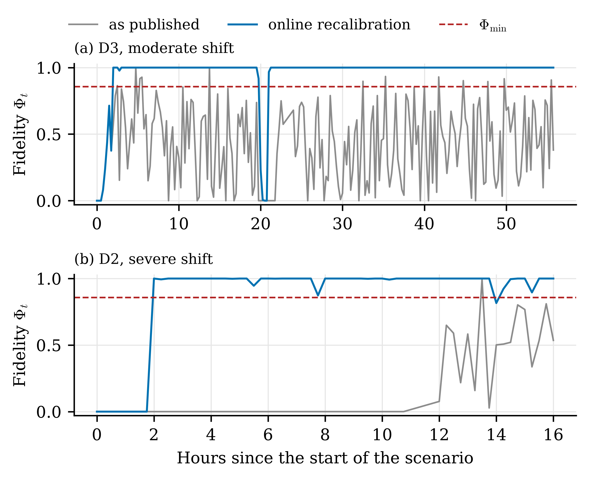

## Actions, agents, rollback, and fallback on a simulated oneM2M SD-IoT network

The public dataset contains no reconfiguration actions, so actions are evaluated on a flow-level simulator of a
oneM2M-based SD-IoT network (`twinguard/sim.py`): the 9-router topology of the dataset, five device groups behind
MN-CSE gateways reporting to the IN-CSE over critical MQTT and CoAP/MQTT telemetry, HTTP best-effort transfers,
alarm storms, capacity degradations, and (in the shift regime) link failures. All randomness is drawn in
advance, so the simulator can be forked and replayed under every candidate action: the outcome of each action is
an exact counterfactual. Two action-conditioned twins are trained on simulated interventions (two seeds each, on a
Kaggle GPU with `notebooks/TwinGuard_revision_training_kaggle.ipynb`): the graph-attention twin and its per-link variant.

**Consequences of actions** (21,719 candidate actions at 1,864 decision epochs): both twins rank the violations of
the candidates' outcomes with an AUROC of 0.989-0.998 and predict the correct sign of 99.3-99.7% of the large effects.
In the simulator, whose links are independent queues, the per-link twin is the more accurate (the action it ranks
best resolves 78.6% / 58.3% of the violations that the no-op would cause, the graph-attention twin 63.6% / 43.2%;
oracle 94.2% / 81.5%).

**Coverage of the selected action:** calibrated on random actions, the bound of the action the agents select covers
0.954 (nominal) but only 0.916 (shift) of its outcomes; with the selection correction eps/(K+1) it covers at least
0.992 (`results/sim/selection_coverage.csv`).

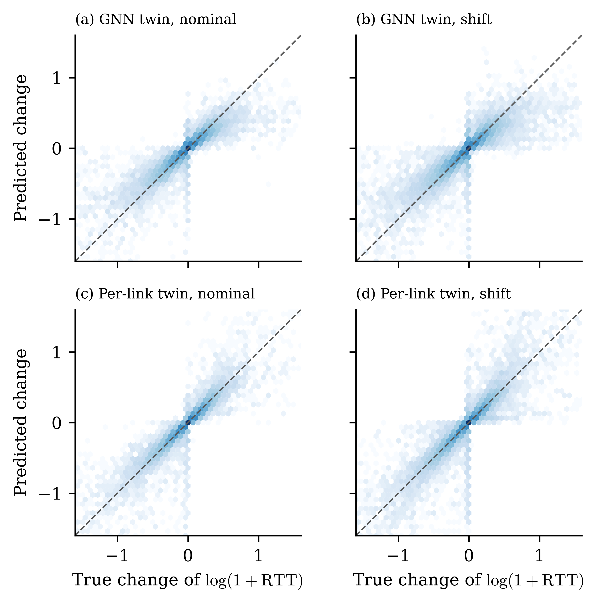

**Closed loop** (same 8 unseen scenarios for every controller; mean SLA violations, % of measured link-epochs):

| Controller | Nominal | Shift | Shift, incl. unmeasured |
|---|---|---|---|
| Static routing | 3.36 | 4.89 | 6.05 |
| Reactive rule | 1.32 | 3.25 | 4.04 |
| Agents + queueing what-if model | 0.28 | 0.40 | 0.48 |
| TwinGuard, original fallback (GNN twin) | 0.53 | 2.25 | 2.83 |
| **TwinGuard, improved fallback (GNN twin)** | **0.18** | **0.20** | **0.24** |
| **TwinGuard, improved fallback (per-link twin)** | **0.07** | **0.11** | **0.12** |
| Oracle | 0.004 | 0.008 | 0.010 |

The improved fallback keeps the last approved configuration and protects the triggering links (strict priority
for the critical class, best-effort meters) instead of resetting the routes. See `results/sim/closed_loop_summary.csv`
for all controllers and metrics (throughput delivered per class, flow-table modifications, route flaps, decision time).

**What the agents add** (per-link twin, improved fallback): without the Monitoring agent violations double
(0.14% / 0.16%); random or exhaustive candidates instead of the Diagnosis and Planning agents keep violations at
0.06-0.10% but deliver only 70-77% of the best-effort traffic (93% with the agents), modify the flow tables 2-3
times as often, and cause route flaps.

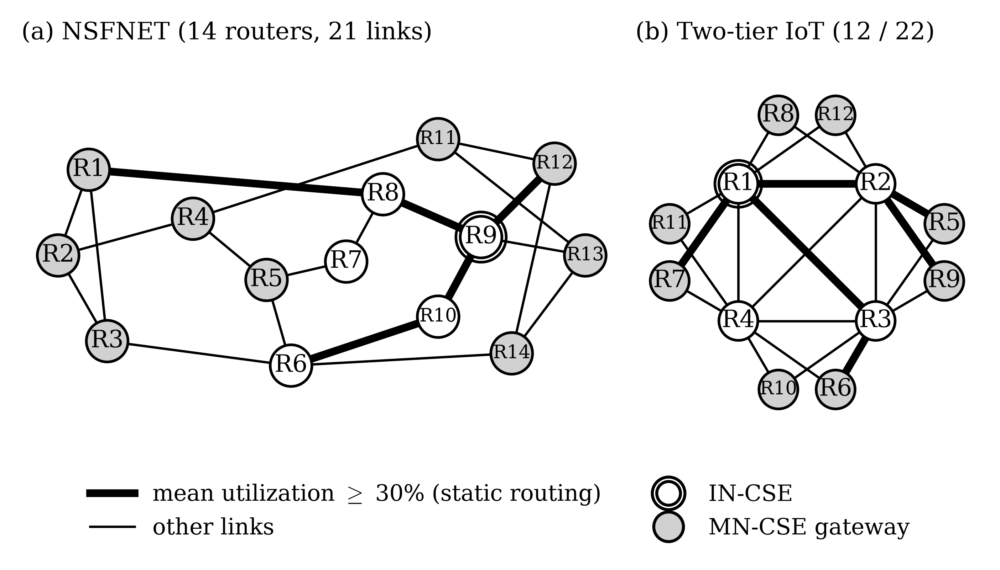

**Other topologies** (`TG_TOPOLOGY=nsfnet`, `TG_TOPOLOGY=two_tier`): on NSFNET (14 routers, 21 links) and a two-tier IoT
access network (12 routers, 22 links), TwinGuard with the improved fallback keeps violations at 0.04-0.16% (nominal)
and 0.15-0.22% (shift), against 1.11-1.18% and 2.45-2.47% for the reactive rule.

**Missing measurements:** with missing outcomes imputed under missing-at-random, TwinGuard's false-approval rate on
the public dataset stays at or below 2.2% (`results/twinguard/missing_outcomes.csv`); in the simulator, with 20%
missing records concentrated on congested links, TwinGuard abstains and the improved fallback keeps 0.73% / 1.04% of
all link-epochs violated (static routing: 4.15% / 6.05%).

**Scope of the guarantee:** the conformal bound is marginal. On the public dataset the average false-approval rate is
at most 1.75%, but single links reach 6.7% (D3) and 9.0% (D2), and approvals close to the budget 5.1-11.9%
(`results/twinguard/guarantee_scope.csv`).

**Equal capacity:** trained in each other's configuration, the GNN twin still beats the per-link GRU at 78k and at 34k
parameters (paired AUROC difference > 0 on D1 test and D3 at 15 s and 60 s; `results/matched_capacity/`).

## Emulated SDN testbed (Mininet + Open vSwitch)

The same controller code drives an emulated testbed (`testbed/`, `twinguard/testbed.py`, `code/14_testbed.py`): nine
Open vSwitch switches (OpenFlow 1.3, secure fail mode), 13 links shaped to 10 Mbps with a best-effort and a
strict-priority queue, UDP traffic replaying the oneM2M device groups and best-effort transfers, and 50 probes per
second on every link. Every 15 s the controller reads the probes, the flow counters, and the port states, decides,
and installs flow-table, meter, and queue changes with `ovs-ofctl`. The twin trained in the simulator is only
recalibrated on one testbed calibration run (AUROC 0.997 on it, without retraining).

SLA violations over the same 45 min of control (% of measured link-epochs; `results/testbed/window_40_220.csv`):

| Controller | Nominal | Shift (2 link failures, degradation, storms) |
|---|---|---|
| Static routing | 7.86 | 2.68 |
| Reactive rule | 3.59 | 1.01 |
| TwinGuard, original fallback | 3.21 | 1.05 |
| **TwinGuard, improved fallback** | **0.98** | **0.48** |

**Decision cycle** (testbed): telemetry collection 55 ms (median), agents' decision with the twin on all candidates
11-14 ms, OpenFlow installation of a reconfiguration 45 ms (186 ms at the 95th percentile); from the end of an epoch
to installed rules about 0.1-0.5 s, against a 15-s period.


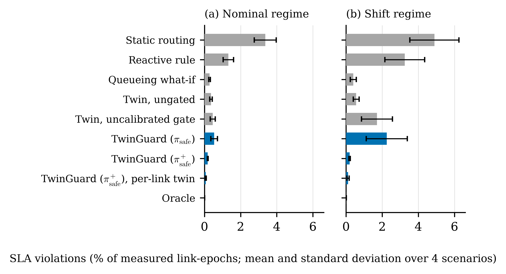

## Repository structure

```
code/
  00_download_data.py       download the dataset from Zenodo and verify its MD5 checksums
  01_dataset_summary.py     dataset audit (records, durations, labels, missing data)
  02_integrity_checks.py    duplicated records and overlap between the scenario files
  03_clean_dataset.py       cleaning protocol and dataset summary
  04_forecast_curves.py     ROC, precision-recall, reliability, and paired horizon comparison of the forecasts
  05_seed_variability.py    standard deviation over seeds: forecasts per seed, TwinGuard on leave-one-seed-out ensembles
  06_sim_data.py            simulator: scenarios under a random exploration policy, training windows
  07_sim_train.py           simulator: training of the action-conditioned twins (graph-attention and per-link, two seeds)
  08_sim_counterfactual.py  simulator: counterfactual outcomes of candidate actions and the models' predictions
  09_sim_closed_loop.py     simulator: closed loop of the controllers, agent ablations, dataset-like missing data
  10_real_recalibration.py  public dataset: online recalibration of TwinGuard and the improved fallback
  11_sim_results.py         simulator: metrics, coverage of the selected action, closed-loop summary
  12_result_figures.py      figures of the simulator experiments and of the recalibration
  13_matched_capacity.py    public dataset: GNN twin vs. per-link GRU at equal numbers of parameters
  14_testbed.py             Mininet / Open vSwitch testbed: calibration run and closed-loop runs
  15_guarantee_and_missing.py  public dataset: scope of the guarantee, false approvals with missing outcomes imputed
  16_kaggle_bundle.py       input bundle of the GPU training notebook
  17_topology_figure.py     figure of the NSFNET and two-tier topologies with their oneM2M roles
  verify.py                 reproducibility check (checkpoints, gate, simulator determinism, closed-loop reference)
  code_sim_common.py        shared helpers of the simulator scripts (topology chosen with TG_TOPOLOGY)
testbed/                    data plane of the testbed (runs in a container): Mininet topology, OVS QoS,
                            traffic generators, link probers
twinguard/                  Python package: twin models, TwinGuard gate, simulator, actions, agents, recalibration
notebooks/
  TwinGuard_experiments.ipynb   data pipeline, exploratory analysis, graph windows, hyperparameter search,
                                training of the GNN twin and the per-link GRU, forecast evaluation,
                                inference cost
  TwinGuard_gate.ipynb          TwinGuard: conformal bounds and ACI, fidelity score, online gate with an
                                independent check, verdicts, fallback comparison, ablations, sensitivity,
                                detection
  TwinGuard_revision_training_kaggle.ipynb   GPU training of the simulator twins (three topologies) and of
                                the equal-capacity models
results/
  *.csv, *.json             hyperparameter search, training summary, forecast metrics, forecast curves,
                            variability over seeds, run information
  0*_*.txt                  outputs of the audit and cleaning scripts
  models/                   the five final checkpoints of each model (weights, history, hyperparameters)
  figs/                     figures of the data analysis and of the training
  twinguard/                coverage, fidelity, verdicts, fallback comparison, ablations, sensitivity,
                            detection, online recalibration (CSV, JSON, figures)
  sim/, sim_nsfnet/, sim_two_tier/   simulator results per topology and the twin checkpoints
  matched_capacity/         equal-capacity comparison and its checkpoints
  testbed/                  testbed runs: summaries, per-epoch logs, and timing of every decision cycle
literature/                 screening log of the literature review
docs/                       architecture, technical architecture, and decision cycle
data/                       dataset location (not versioned; see data/README.md)
```

Both notebooks are stored **with their outputs**, so every reported number can be checked without
re-running them.

## Setup

Python 3.11 or newer.

```bash
python -m venv .venv
source .venv/bin/activate          # Windows: .venv\Scripts\activate
pip install -r requirements.txt
```

The training notebook uses a GPU when one is available; it was run on Kaggle (NVIDIA Tesla T4) in about
30 min. Everything else runs on a CPU in seconds to a minute.

## Reproducing the results

Run every command from the repository root.

**1. Data and audit (CPU, about 1 min).**

```bash
python code/00_download_data.py
python -I code/01_dataset_summary.py data/zenodo_17255307 > results/01_dataset_summary.txt
python -I code/02_integrity_checks.py data/zenodo_17255307 > results/02_integrity_checks.txt
python -I code/03_clean_dataset.py data/zenodo_17255307 data/processed > results/03_clean_dataset.txt
```

`03_clean_dataset.py` writes the cleaned files `data/processed/{D1,D2,D3}.csv`. The published D2 file
begins with three identical copies of the last D1 segment; the cleaning keeps only D2 records from
2025-07-01 00:00 UTC on.

**2. Models and forecasts (GPU recommended).**
Run `notebooks/TwinGuard_experiments.ipynb`. It builds the graph windows
(`data/processed/graph_pipeline.npz`), runs the hyperparameter search (16 configurations per model),
trains five seeds of the GNN twin and of the per-link GRU, and writes the predictions of every model on
every split to `results/preds/`, together with the checkpoints, metrics, and figures. On Kaggle, add the
folder `data/processed/` as a dataset (or let the setup cell download the data) and enable a GPU; all
outputs are zipped into `twinguard_outputs.zip`.

**3. TwinGuard (CPU, about 1 min).**
Run `notebooks/TwinGuard_gate.ipynb`. It needs `results/preds/` and `data/processed/graph_pipeline.npz`
from step 2 and writes everything in `results/twinguard/`. The notebook stops with an error if the online
gate and the independent vectorized implementation disagree.

**4. Forecast curves and variability over seeds (CPU, about 4 min).**

```bash
python code/04_forecast_curves.py      # results/figs/fig_{roc_pr,reliability,horizon_gap}.png, results/model_curves.json
python code/05_seed_variability.py     # results/seed_variability_{forecast,gate}.csv, results/seed_variability.json
```

Both use the predictions of step 2. `05_seed_variability.py` runs the code of `TwinGuard_gate.ipynb` five
times, each time on a four-member ensemble that leaves out one seed.

**5. Online recalibration on the public dataset (CPU, seconds).**

```bash
python code/10_real_recalibration.py   # results/twinguard/recalibration.csv; no model is retrained
```

The script first checks that, without recalibration, it reproduces the published TwinGuard verdicts exactly.

**6. Simulated oneM2M SD-IoT network (CPU; GPU for the twins).**

```bash
python code/06_sim_data.py             # data/sim/ (about 1 min); add TG_TOPOLOGY=nsfnet or two_tier for the other topologies
python code/16_kaggle_bundle.py        # kaggle/twinguard_kaggle_inputs.zip
# run notebooks/TwinGuard_revision_training_kaggle.ipynb on a Kaggle GPU (about 35 min) and unpack
# twinguard_outputs.zip into results/; on a CPU, python code/07_sim_train.py trains the same models (hours)
python code/08_sim_counterfactual.py   # results/sim/counterfactual.npz (minutes); "cal" for the calibration forks
python code/09_sim_closed_loop.py      # results/sim/closed_loop.csv (about 20 min)
python code/11_sim_results.py          # metrics of both experiments
TG_TOPOLOGY=nsfnet TG_HOURS=3 python code/08_sim_counterfactual.py   # likewise for two_tier, then 09 and 11
```

**7. Public dataset: equal capacity, scope of the guarantee, missing outcomes (CPU, minutes).**

```bash
python code/13_matched_capacity.py     # evaluates the checkpoints of results/matched_capacity/models
python code/15_guarantee_and_missing.py
```

**8. Testbed (Linux with Docker; about 75 min of wall-clock time per run).**
The data plane runs in a privileged container with Mininet 2.3 and Open vSwitch 2.13 (Ubuntu 20.04); the host needs
the `openvswitch` kernel module.

```bash
docker build -t twinguard-testbed:latest testbed/
python code/14_testbed.py cal                                    # calibration run (exploration policy)
python code/14_testbed.py run static nominal                     # also: reactive, TwinGuard, "TwinGuard, improved fallback"; shift
python code/14_testbed.py window                                 # SLA violations of all runs over epochs 40-219
python code/14_testbed.py summary                                # per-run summaries and decision-cycle timing
```

**9. Verification (CPU, a few minutes).**

```bash
python code/verify.py
```

It checks that every shipped checkpoint loads and runs, the conformal gate, the bit-for-bit determinism of the
simulator, and a 1-h closed loop against a stored reference, and, once the data and predictions of steps 1-2 exist,
that TwinGuard reproduces the published gate metrics exactly. The same check runs on every push
(`.github/workflows/verify.yml`).

## What is versioned

| Path | Contents |
|---|---|
| `results/*.csv`, `results/*.json` | hyperparameter search, training summary, forecast metrics with bootstrap intervals, forecast curves, variability over seeds, run information |
| `results/0*_*.txt` | outputs of the audit and cleaning scripts |
| `results/models/` | the five final checkpoints of each model |
| `results/figs/`, `results/twinguard/` | figures and tables written by the notebooks and scripts |
| `results/sim*/` | simulator results of the three topologies and the checkpoints of the simulator's twins |
| `results/matched_capacity/` | equal-capacity comparison and its 20 checkpoints |
| `results/testbed/` | testbed summaries, per-epoch logs, and decision-cycle timing |

Not versioned because of their size: the raw and cleaned data (downloaded by step 1), the graph windows,
the per-split predictions (about 210 MB, recreated by step 2), the checkpoints of the hyperparameter
search, and the simulator data and counterfactual outcomes (recreated by step 6).

## Data

The evaluation dataset is *Network Digital Twin-Generated Dataset for Machine Learning-based Smart
QoS-aware Zero-Touch Traffic Engineering* by Sanz Rodrigo et al. (Zenodo, 2025,
[doi:10.5281/zenodo.17255307](https://doi.org/10.5281/zenodo.17255307)), released under CC-BY 4.0. It is
not redistributed here; `code/00_download_data.py` downloads it and checks every file against the MD5
checksum published by Zenodo.

## Citation

If you use this code, please cite the paper (see `CITATION.cff`). The reference will be updated once the
paper is published.

## License

The code in this repository is released under the MIT License (see `LICENSE`). The dataset is the work of
its authors and is licensed separately under CC-BY 4.0.
